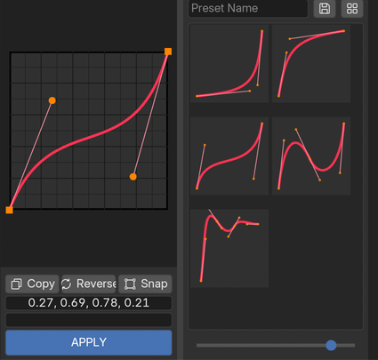
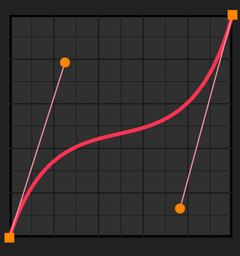
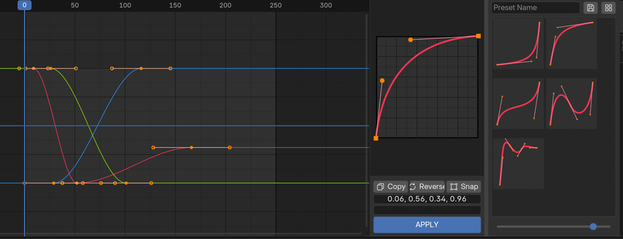
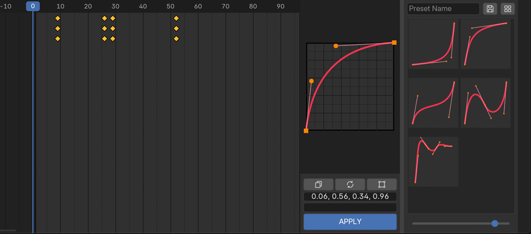
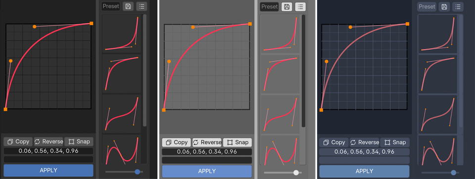

# B-Ease Studio 2

ドキュメント [English](README.md) / [Japanese](README.ja.md)

B-Ease Studio 2 は、Blender の F カーブを編集し、イージングのコピーやプリセット保存ができるアドオンです。

通常の 2 点間のカーブだけでなく中間ポイントを追加した複数区間のカーブにも対応しています。

**動作確認OS：Windows、macOS**　

**対応バージョン：Blender4.2以降**

## インストール

[GitHub Releases](<https://github.com/NisaiAE/b-ease-studio/releases>) または BOOTH から、インストール用の `b_ease_studio_2-x.x.x.zip` をダウンロードしてください。

1. 「編集 > プリファレンス > エクステンションを入手」を開く。
2. 一番右上の「∨」ボタン→「ディスクからインストール」をクリックし、ダウンロードした「b_ease_studio_2-◯.◯.◯.zip」を選択。
3. 「アドオン」で「B-Ease Studio 2」にチェックが付き、有効になっていることを確認します。

## 使用方法

- Blenderを起動後、グラフエディターを開き、N キーを押し、右側のサイドバーから「B-Ease」タブを開きます。ヘッダーにある「B-Ease」ボタンでも開閉可能です。
- サイドバーの境界をドラッグして幅を変更できます。また、カーブエディタとプリセットリストの間にある仕切りをドラッグすると左右の表示幅を調整できます。
- 「編集 > プリファレンス > アドオン > B-Ease Studio 2」にある   
  ・Show in Dope Sheet  
  ・Show in Timeline  
  でドープシート、またタイムラインでも表示するかをそれぞれ切り替えることができます。  
  デフォルトでドープシートはオン、タイムラインはオフになっています。

## 機能



**基本的な使い方**

1. グラフエディターなどで、同じ F カーブ上の隣り合ったキーフレームを 2 つ選択します。
2. B-Ease のハンドルをドラッグしてカーブを調整します。
3. APPLY ボタンを押すと、選択したキーフレーム間にカーブが適用されます。
4. 既存のカーブを元に編集したい場合は Copy、保存済みのカーブを使いたい場合はプリセットを選択します。

### カーブエディタ



- ハンドルを操作して自由にカーブを編集できます。
- 何もない場所をダブルクリックすると中間ポイントを追加できます。  
  右クリックメニューの「Add Point」からも追加できます。
- 中間ポイントはドラッグで移動できます。始点と終点の位置は固定されています。
- Shift + クリック またはドラッグによる範囲選択で複数のポイントを選択できます。  
  複数選択したポイントはまとめて移動でき、ハンドルも同じ側を一括で調整できます。
- 中間ポイントを右クリックすると、削除やハンドルの Free / Aligned を切り替えられます。
- Free は左右のハンドルを個別に動かすモード、Aligned は方向を一直線に保つモードです。

**主なショートカット・マウス操作**

| 操作  | 内容  |
| --- | --- |
| A / Alt + A | 全ポイントを選択 / 選択解除 |
| X / Delete / Backspace | 選択中の中間ポイントを削除 |
| V   | 選択中の中間ポイントの Free / Aligned を切り替え |
| Shift + 範囲選択 | ポイントを追加選択 |
| Ctrl（⌘） + 範囲選択 | 範囲内の選択を解除 |
| マウスホイール | カーブの表示を拡大・縮小 |
| 中マウスボタンをドラッグ | 表示位置を移動 |
| Home | 拡大率と表示位置をリセット |
| ドラッグ中に Esc または右クリック | 移動を取り消し |

### 適用（APPLY）





グラフエディター、ドープシート、タイムラインでキーフレームを選択し**APPLY** ボタンを押すと、現在のカーブを F カーブに適用できます。  

1. **選択したキーの数と B-Ease のポイント数が同じ場合：** 各区間にカーブを順番に適用します。既存のキーの位置は変わらず、キーは新規追加されません。
2. **数が異なる場合：** 隣り合う選択キーの各区間に、B-Ease のカーブ全体を適用します。中間ポイントがある場合はその位置にキーフレームが新規追加されます。
3. **キーを 1 つだけ選択した場合：** そのキーから次のキーまでの区間に適用します。最後のキーだけを選択した場合は適用されません。

- 未選択のキーをまたぐ区間、両端の値が同じ区間、ロックされた F カーブなどには適用できません。
- 追加するキーが既存のキーと重なる場合も、その区間は適用されません。
- 適用した区間はベジェ補間になり、その先の区間の補間設定は維持されます。
- 適用区間の両端キーでは範囲外のカーブ形状を保つため、外側ハンドルが Free に変更される場合があります。
- APPLY の操作は Blender の「元に戻す（Undo）」で取り消せます。

### コピー（Copy）

- 連続する 2 つ以上のキーフレームを選択しCopy ボタンを押すと、その範囲のカーブを B-Ease にコピーできます。
- 中間キーを含むカーブもコピーできます。
- 複数の F カーブに選択キーがある場合は、条件を満たした最初の 1 本がコピーされます。コピーしたい F カーブだけを表示・選択すると確実です。
- 両端の値が同じ場合や、時間間隔が小さすぎる場合はコピーできません。
- Linear・Constant 補間や F カーブモディファイアの結果は取り込めません。

### 反転（Reverse）

- **Reverse** ボタンを押すと、現在のカーブを反転（180 度回転）できます。

### スナップ（Snap）

- **Snap** をオンにすると、ポイントとハンドルの位置が 0.01 刻みでスナップされます。
- オンにした時点で現在のカーブも 0.01 刻みにそろえられます。
- Snap がオンのままプリセットを読み込んだり Copy・Reverse を行った場合、読み込んだカーブ全体は自動でそろえ直されません。必要に応じて Snap を一度オフにしてからオンにしてください。

### テキストボックス

カーブエディタの下にある 2 つのテキストボックスから、座標を直接編集できます。数値は半角のカンマで区切って入力します。

- **上段：ハンドルの座標** — 1 区間につき「X, Y, X, Y」の順に 4 つの数値を入力します。複数区間の場合は左から順に並びます。
- **下段：中間ポイントの座標** — 1 ポイントにつき「X, Y」の順に入力します。ポイントを選択していない状態で数値の組を増減すると、中間ポイントの追加・削除もできます。

ポイントを選択している間は、両方のテキストボックスが選択したポイントに対応する値へ切り替わります。

始点・終点は固定のため、座標を変更できません。

テキストボックスをダブルクリックすると全文を選択できます。コピー・貼り付けにも対応しています。

## プリセット機能

### プリセット保存

- 「Preset Name」をクリックして名前入力画面を開き名前を入力し、保存ボタンを押すことで現在のカーブがプリセットとして追加されます。
- プリセット名を入力しなかった場合名前なしで保存されます

### プリセットリスト

- プリセットをクリックすると保存したカーブがカーブエディタに読み込まれます。
- プリセットを右クリックすると、**Rename...（名前変更）** と **Delete...（削除）** を選択できます。
- プリセットをドラッグ＆ドロップすると順番を変更できます。

### プリセット表示切り替え

- **リストモード：** プリセットが縦に並びます。
- **グリッドモード：** プリセットがグリッド状に並びます。
- 表示切り替えボタンでモードを変更し、下部のスライダーでサムネイルのサイズを変更できます。

## 設定データの保存場所

プリセットと設定は `.blend` ファイルとは別に、Blender のユーザー設定フォルダ内にある `settings2.json` に保存されます。

**Blender のユーザー設定フォルダ**

Windows：

```
%APPDATA%\Blender Foundation\Blender\[バージョン]\

```

macOS：

```
~/Library/Application Support/Blender/[バージョン]/

```

上記のフォルダを基準とした保存先は以下のとおりです。

```
extensions/.user/[リポジトリ識別名]/b_ease_studio_2/settings2.json

```

※ `[バージョン]` と `[リポジトリ識別名]` は使用環境によって異なります。

プリセットの追加・削除・名前変更・並べ替え、仕切りの位置変更、アドオンの無効化時に設定が保存されます。

### バックアップと旧版からの引き継ぎ

- 設定をバックアップする場合は Blender を終了し、保存先フォルダを丸ごとコピーしてください。`settings2.json.bak` は自動で作成されるバックアップファイルです。
- B-Ease Studio v1.◯.◯を使用していた場合、旧版の `settings.json` にあるプリセットや設定を自動で取り込みます。
- **アンインストールすると設定データも削除されます。** 必要なプリセットはアンインストール前にバックアップしてください。通常のアップデートでは設定データは保持されます。

## その他仕様

- Copy と APPLY は、操作したグラフエディター・ドープシート・タイムラインで**表示されているチャンネルの選択キー**を対象とします。フィルターやピン留めの状態によって対象が変わるため、適用前に確認してください。
- キーフレームのハンドルだけを選択しても Copy・APPLY の対象にはなりません。キー本体を選択する必要があります。
- オブジェクトやオブジェクトデータに設定された Action の F カーブに対応しています。ドライバーの F カーブは対象外です。Blender 4.4 以降の Action スロットにも対応しています。
- UI の色は Blender のテーマに合わせて自動で変わります。



## アンインストール手順

1. 必要なプリセットがある場合は、先に設定データをバックアップしてください。
2. 「編集 > プリファレンス」の「エクステンションを入手」から B-Ease Studio 2 をアンインストールします。

## 更新履歴

**2026/11/01 ver2.0.0**

**・リリース**

## 利用規約

B-Ease Studio 2 は **GPL-3.0-or-later** ライセンスで提供しています。商用・法人利用も可能です。

ソフトウェアは無保証で提供され、不具合などによって生じた損害についても責任を負いません。

法人で利用される場合、可能であればメールでの使用報告や、作品への「ツール開発協力：Nisai」などのクレジット表記にご協力いただけると幸いです。いずれも必須ではありません。

不明な点や不具合報告・要望などは、Twitter の DM で受け付けています。

- Twitter：[https://twitter.com/muriminium](https://twitter.com/muriminium)
- メール：[nisaiwork@gmail.com](mailto:nisaiwork@gmail.com)

## 制作者

**Nisai**

Twitter：[https://twitter.com/muriminium](https://twitter.com/muriminium)  
HP：[https://muriminium.com](https://muriminium.com/)
