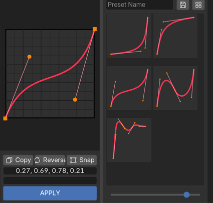
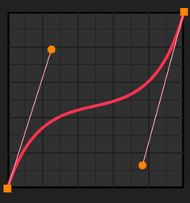
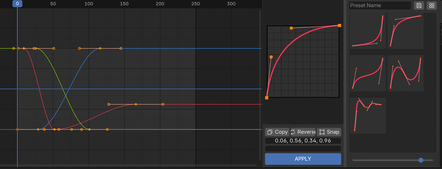
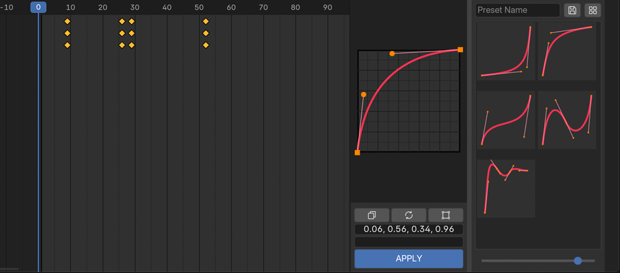
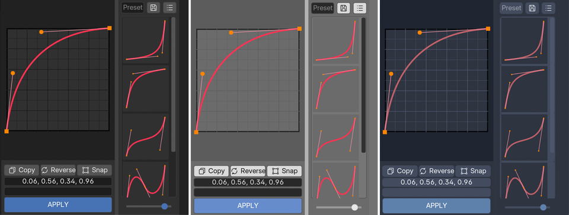

# B-Ease Studio 2

Documentation [English](README.md) / [Japanese](README.ja.md)

B-Ease Studio 2 is a Blender add-on for editing F-Curves, copying easing curves, and saving them as presets.

In addition to standard curves between two points, it supports curves with multiple segments created by adding intermediate points.

**Tested operating systems: Windows, macOS**

**Supported versions: Blender 4.2 or later**

## Installation

**From a ZIP file**

1. Open "Edit > Preferences > Get Extensions".
2. Click the "∨" button in the upper-right corner, select "Install from Disk", and choose the downloaded `b_ease_studio_2-x.x.x.zip` file.
3. Under "Add-ons", check that "B-Ease Studio 2" is checked and enabled.

**From Blender Extensions**

1. Open "Edit > Preferences > Get Extensions".
2. Enter "B-Ease Studio 2" in the search field.
3. When "B-Ease Studio 2" appears, click "Install".
4. Under "Add-ons", check that "B-Ease Studio 2" is checked and enabled.

## Getting Started

- After starting Blender, open the Graph Editor, press N, and open the "B-Ease" tab in the sidebar on the right. You can also toggle it with the "B-Ease" button in the header.
- Drag the sidebar border to change its width. You can also drag the divider between the curve editor and the preset list to adjust the widths of the left and right sections.
- Under "Edit > Preferences > Add-ons > B-Ease Studio 2", use  
  ・Show in Dope Sheet  
  ・Show in Timeline  
  to choose whether to show the add-on in the Dope Sheet and Timeline, respectively.  
  By default, it is enabled in the Dope Sheet and disabled in the Timeline.

## Features



**Basic Usage**

1. In the Graph Editor or another animation editor, select two adjacent keyframes on the same F-Curve.
2. Drag the handles in B-Ease to adjust the curve.
3. Press APPLY to apply the curve between the selected keyframes.
4. To edit an existing curve, use Copy. To use a saved curve, select a preset.

### Curve Editor



- Edit the curve freely by moving its handles.
- Double-click an empty area to add an intermediate point.  
  You can also use "Add Point" in the right-click menu.
- Drag intermediate points to move them. The start and end points have fixed positions.
- Use Shift + click or drag a selection box to select multiple points.  
  Selected points can be moved together, and their handles on the same side can be adjusted together.
- Right-click an intermediate point to delete it or switch its handles between Free and Aligned.
- Free lets you move the left and right handles independently. Aligned keeps them in a straight line.

**Common Shortcuts and Mouse Controls**

| Control | Action |
| --- | --- |
| A / Alt + A | Select / deselect all points |
| X / Delete / Backspace | Delete selected intermediate points |
| V | Switch the handles of selected intermediate points between Free and Aligned |
| Shift + box select | Add points to the selection |
| Ctrl (⌘) + box select | Deselect points within the box |
| Mouse wheel | Zoom the curve view in or out |
| Middle-mouse drag | Pan the view |
| Home | Reset the zoom and view position |
| Esc or right-click while dragging | Cancel the move |

### Apply (APPLY)





Select keyframes in the Graph Editor, Dope Sheet, or Timeline and press **APPLY** to apply the current curve to the F-Curve.

1. **When the number of selected keys matches the number of points in B-Ease:** The curve segments are applied to the keyframe intervals in order. Existing keys stay in place, and no new keys are added.
2. **When the numbers differ:** The entire B-Ease curve is applied to each interval between adjacent selected keys. If the curve has intermediate points, new keyframes are added at those positions.
3. **When only one key is selected:** The curve is applied from that key to the next key. Nothing is applied if only the last key is selected.

- The curve cannot be applied to intervals that span unselected keys, intervals with equal values at both ends, or locked F-Curves, among other cases.
- An interval is also skipped if a key to be added would overlap an existing key.
- Applied intervals use Bézier interpolation. Interpolation settings for subsequent intervals are preserved.
- The outer handles of the keys at both ends of the applied range may be changed to Free to preserve the curve shape outside that range.
- APPLY can be undone using Blender's Undo command.

### Copy

- Select two or more consecutive keyframes and press Copy to copy the curve in that range into B-Ease.
- You can also copy curves that contain intermediate keys.
- If keys are selected on multiple F-Curves, the first curve that meets the conditions is copied. To ensure that the intended curve is copied, display and select only that F-Curve.
- A curve cannot be copied if the values at both ends are equal or the time interval is too small.
- Linear or Constant interpolation and the results of F-Curve modifiers cannot be copied.

### Reverse

- Press **Reverse** to reverse the current curve (rotate it by 180 degrees).

### Snap

- Enable **Snap** to snap point and handle positions to increments of 0.01.
- Enabling it also snaps the current curve to increments of 0.01.
- If you load a preset or use Copy or Reverse while Snap is already enabled, the entire loaded curve is not automatically snapped again. If needed, turn Snap off and then back on.

### Text Fields

The two text fields below the curve editor let you edit coordinates directly. Separate values with standard commas.

- **Upper field: handle coordinates** — Enter four values for each segment in the order "X, Y, X, Y". For multiple segments, enter them from left to right.
- **Lower field: intermediate point coordinates** — Enter two values for each point in the order "X, Y". When no points are selected, adding or removing pairs of values also lets you add or delete intermediate points.

While points are selected, both fields show values corresponding to the selected points.

The start and end points are fixed, so their coordinates cannot be changed.

Double-click a text field to select all of its text. Copy and paste are also supported.

## Preset Features

### Saving Presets

- Click "Preset Name" to open the name entry dialog, enter a name, and press the save button to add the current curve as a preset.
- If no preset name is entered, the preset is saved without a name.

### Preset List

- Click a preset to load its saved curve into the curve editor.
- Right-click a preset to choose **Rename...** or **Delete...**.
- Drag and drop presets to change their order.

### Switching the Preset View

- **List mode:** Presets are arranged vertically.
- **Grid mode:** Presets are arranged in a grid.
- Use the view toggle button to switch modes and the slider at the bottom to change the thumbnail size.

## Settings Storage Location

Presets and settings are saved separately from `.blend` files in `settings2.json` inside Blender's user settings folder.

**Blender's user settings folder**

Windows:

```
%APPDATA%\Blender Foundation\Blender\[version]\

```

macOS:

```
~/Library/Application Support/Blender/[version]/

```

The storage path relative to the folder above is:

```
extensions/.user/[repository identifier]/b_ease_studio_2/settings2.json

```

`[version]` and `[repository identifier]` vary depending on your setup.

Settings are saved when you add, delete, rename, or reorder presets, change the divider position, or disable the add-on.

### Backups and Migration from Earlier Versions

- To back up your settings, close Blender and copy the entire settings folder. `settings2.json.bak` is an automatically created backup file.
- If you have used B-Ease Studio v1.x.x, presets and settings from the earlier version's `settings.json` are imported automatically.
- **Uninstalling the add-on also deletes its settings data.** Back up any presets you need before uninstalling. Settings data is preserved during normal updates.

## Other Details

- Copy and APPLY operate on **selected keys in the channels visible** in the Graph Editor, Dope Sheet, or Timeline where you use them. Filters and pinned data can change which channels are affected, so check before applying.
- Selecting only keyframe handles does not make those keys eligible for Copy or APPLY. Select the keys themselves.
- F-Curves in Actions assigned to objects or object data are supported. Driver F-Curves are not supported. Action slots in Blender 4.4 and later are also supported.
- The UI colors automatically follow Blender's theme.



## Uninstallation

1. If you have presets you want to keep, back up your settings data first.
2. Uninstall B-Ease Studio 2 from "Get Extensions" under "Edit > Preferences".

## Version History

**2026/11/01 ver2.0.0**

**・Release**

## Terms of Use

B-Ease Studio 2 is provided under the **GPL-3.0-or-later** license. Commercial and corporate use are permitted.

The software is provided without warranty. The developer is not liable for damages arising from bugs or other issues.

If you use the add-on at a company, it would be appreciated if you could let me know by email or include a credit such as "Tool development assistance: Nisai" in your work. Neither is required.

Questions, bug reports, and feature requests are welcome through Twitter DMs.

- Twitter: [https://twitter.com/muriminium](https://twitter.com/muriminium)
- Email: [nisaiwork@gmail.com](mailto:nisaiwork@gmail.com)

## Author

**Nisai**

Twitter: [https://twitter.com/muriminium](https://twitter.com/muriminium)  
Website: [https://muriminium.com](https://muriminium.com/)
